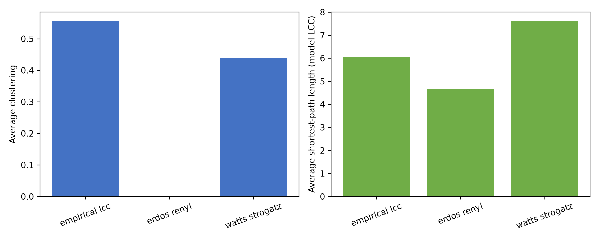

# Small-world and random-graph model comparison

The LCC is compared with Erdős–Rényi `G(n,m)` graphs matched to its node and edge counts, and Watts–Strogatz graphs matched to its node count and the nearest even integer to its average degree (`k`), with rewiring probability `p = 0.1`. Three independently seeded realizations are generated for each model by default. The code reports mean and sample standard deviation for model clustering and path length, along with the mean fraction of nodes in the model's largest component.

Average clustering is measured on each complete generated model. Average shortest-path length is measured on its largest connected component, so the path comparison remains defined if a generated graph is disconnected. For the empirical graph, these quantities are measured on the LCC. The small-world coefficient is

`sigma = (C_empirical / C_ER) / (L_empirical / L_ER)`,

where `C` is average clustering and `L` is the average shortest-path length in the relevant connected component. A value substantially above one indicates more clustering than expected for comparable path length under the ER baseline. This comparison is descriptive: ER and WS do not preserve the empirical degree sequence, and the matched-`k` WS graph need not have exactly the empirical edge count.

## Results

The empirical LCC has average clustering `C = 0.5569` and average path length `L = 6.0494`. Across three ER realizations, clustering is `0.001542 ± 0.000398` and path length is `4.6782 ± 0.0033`; their giant components contain 99.83% of the nodes on average. The resulting empirical-versus-ER small-world coefficient is `sigma = 279.3`. This large value is driven primarily by the empirical network's far greater clustering, while its paths are only moderately longer than the ER giant component's.

The matched-`k` WS graphs (`k = 6`) have clustering `0.4378 ± 0.0037` and path length `7.6231 ± 0.0627`, with all nodes in the giant component. Their edge count (12,474) is below the empirical LCC's 13,422 because matching `N` and an even `k` does not match the empirical edge count exactly. The empirical network has both higher clustering and shorter paths than these WS realizations.

The model gaps show why neither null is a full explanation of the collaboration network. ER supplies a matched size and edge count but lacks the observed clustering and heterogeneous collaboration structure. WS captures high clustering with short paths qualitatively, but its regular degree construction does not reproduce the empirical hubs, communities, or observed path statistics. In particular, sigma is a comparison to ER, not a claim that the network follows a specific generative model.
