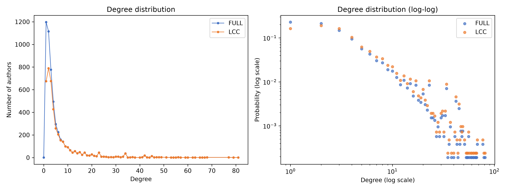
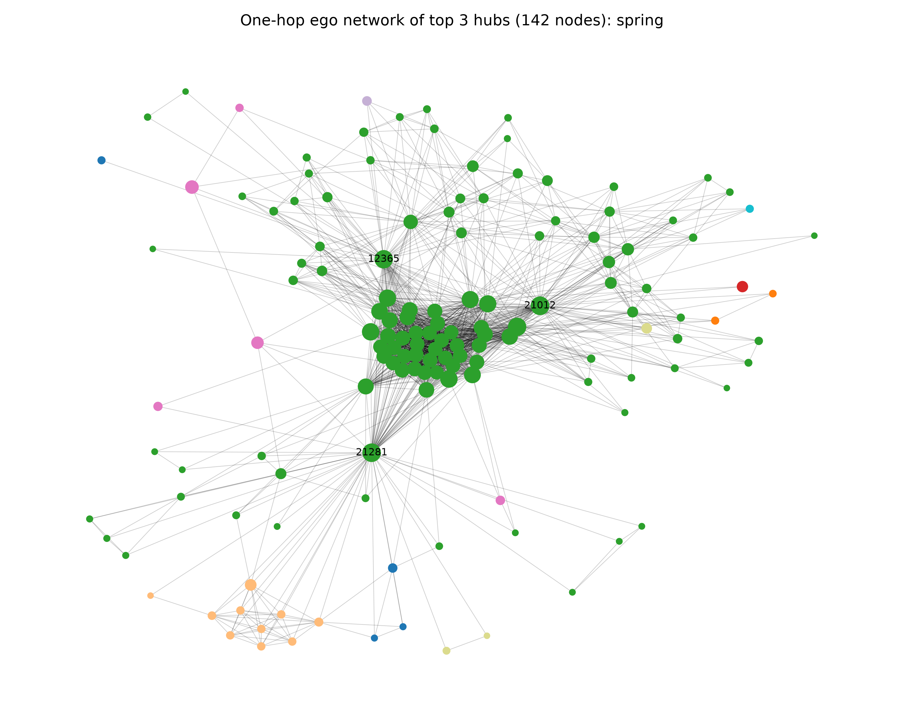
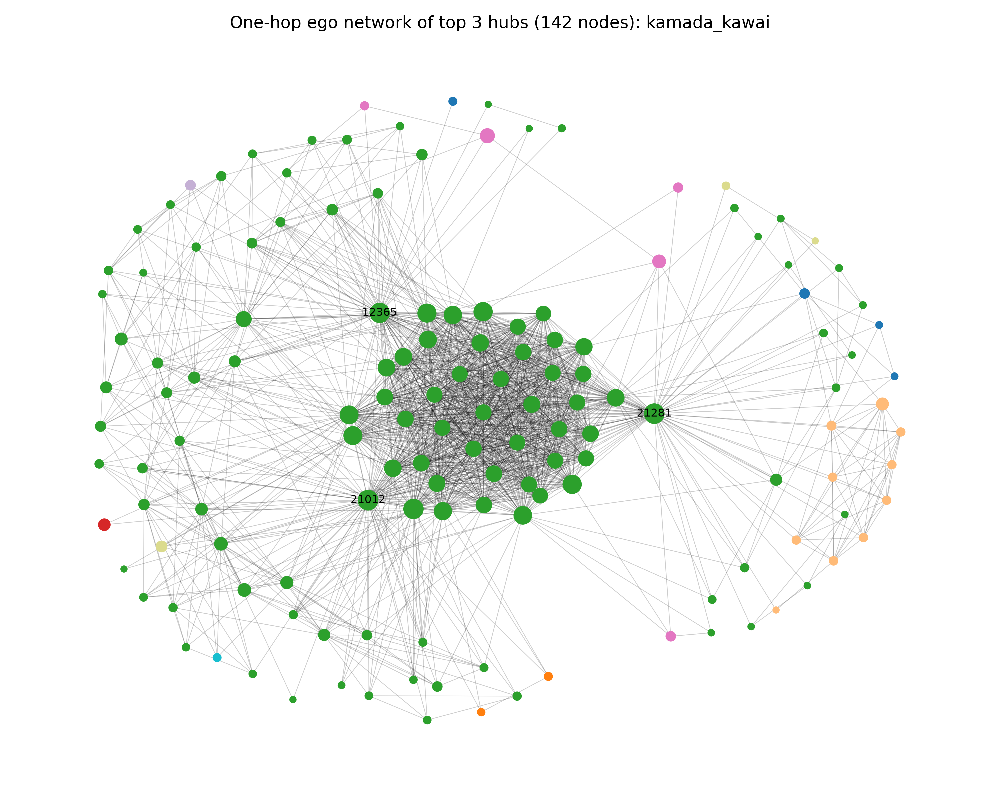

# Structural analysis and results

## Full graph and largest connected component

| Graph | Nodes | Edges | Density | Average degree | Components | Clustering | Transitivity | Average path length | Diameter |
|---|---:|---:|---:|---:|---:|---:|---:|---:|---:|
| Full | 5,242 | 14,484 | 0.001054 | 5.526 | 355 | 0.5296 | 0.6298 | Not defined | Not defined |
| LCC | 4,158 | 13,422 | 0.001553 | 6.456 | 1 | 0.5569 | 0.6289 | 6.0494 | 17 |

The LCC retains 79.3% of the authors and 92.7% of the edges. Restricting to it excludes 1,084 nodes and 1,062 edges; the full graph has 354 other connected components in addition to the LCC. The full graph's global path length and diameter are not defined because pairs of authors in different components have no connecting path. The LCC is sparse by density but has substantial local clustering, consistent with tightly connected co-author groups.

The degree distributions are shown on linear and log-log axes for both graph versions. The log-log view is descriptive and is not, by itself, evidence of a power law; formal distribution fitting is covered separately.

## Centrality

The degree leader is author ID 21012 (degree 81). Approximate betweenness is led by ID 13801 (degree 45), while closeness is also led by ID 13801. The fact that the degree leader and betweenness leader differ illustrates that direct collaborator count and shortest-path brokerage are distinct roles. PageRank emphasizes both node connectivity and the importance of its neighbors.

| Measure pair | Spearman rank correlation |
|---|---:|
| Degree / approximate betweenness | 0.661 |
| Degree / closeness | 0.498 |
| Degree / PageRank | 0.913 |
| Approximate betweenness / closeness | 0.525 |
| Approximate betweenness / PageRank | 0.770 |
| Closeness / PageRank | 0.359 |

Degree and PageRank rankings are closely aligned, whereas closeness has weaker alignment with the other measures. The top-ten lists, which make the differences between individual authors visible, are in `tables/A/centrality_top10.csv`; correlations are over all 4,158 LCC authors. Betweenness uses 500 sampled sources, so its values are estimates.

## Communities

| Method | Communities | Modularity | Largest community |
|---|---:|---:|---:|
| Louvain | 40 | 0.8480 | 275 authors |
| Greedy modularity | 62 | 0.7993 | 930 authors |

Both methods identify modular structure, but their partitions differ substantially. Louvain returns fewer communities and higher modularity, while greedy modularity has more communities but a much larger leading group. The five highest-degree authors in the LCC all belong to one 219-author Louvain community, whereas Louvain's largest (275-author) group is led by different authors. Greedy modularity also groups those five top-degree authors in a single 400-author community. These results suggest the strongest hubs are associated with one another, but the exact community boundaries depend on the method and should not be treated as unique research-group labels.

## Representative visualization

The plotted 142-node subnetwork is the union of the one-hop neighborhoods of the three highest-degree authors. Node size scales with degree and color represents the Louvain community; labels identify the three hubs. It is a focused view rather than a full-network map.

Full metric tables, component-size distributions, community assignments summarized by size, and centrality rankings are saved as CSV files under `tables/A/`.
